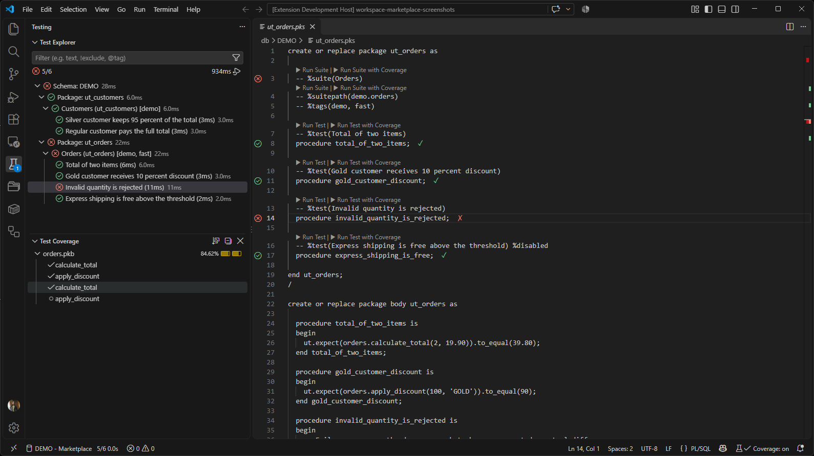
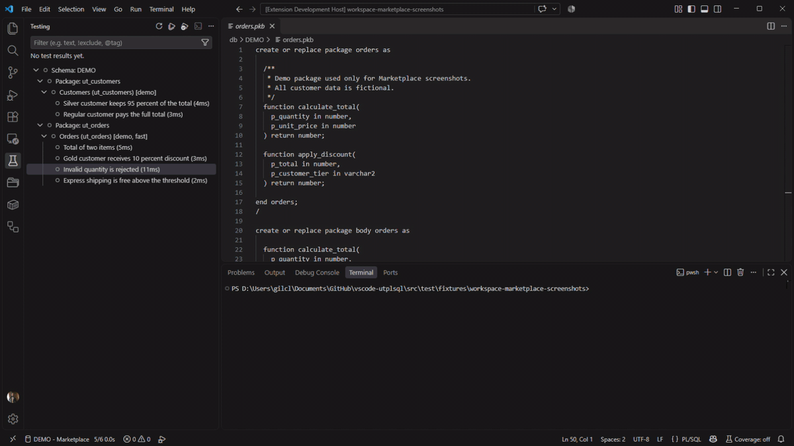
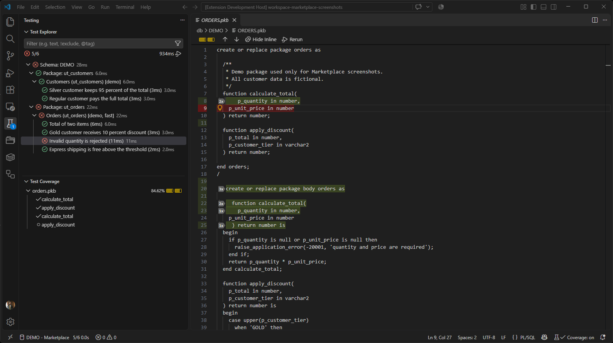
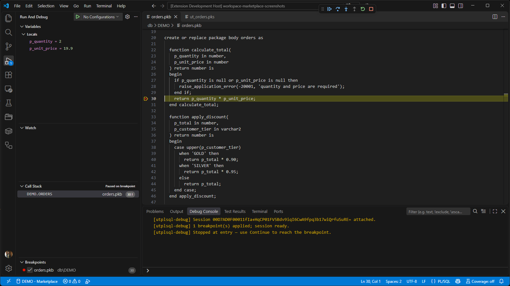
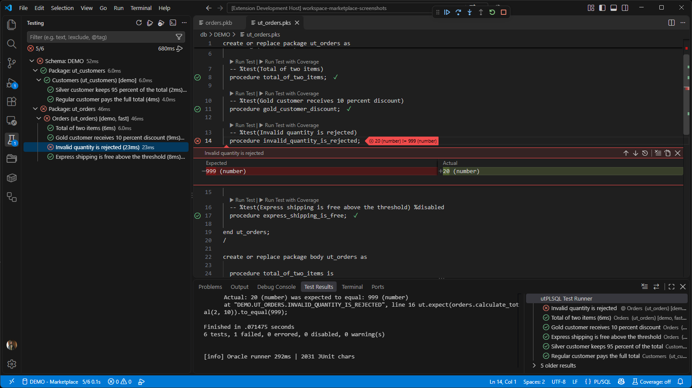
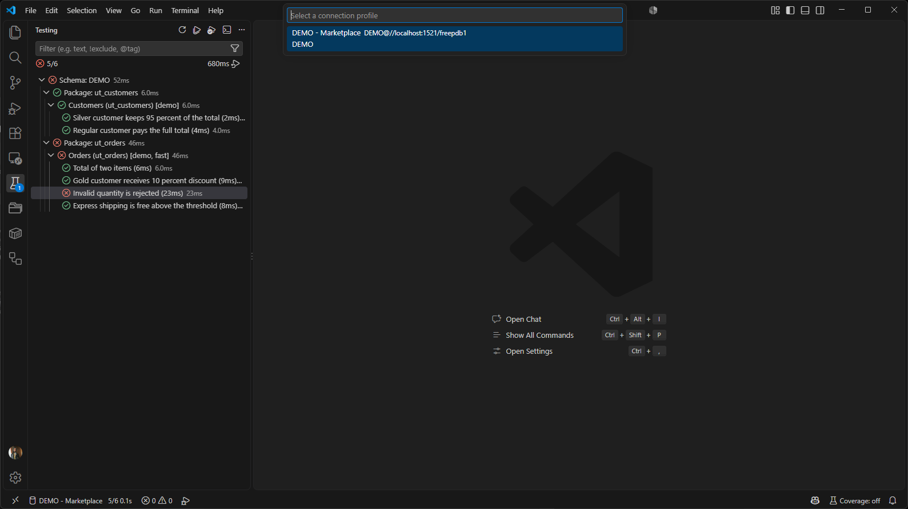

<!-- GENERATED FROM docs/brain/60-README/Marketplace (README).md — DO NOT EDIT -->

# utPLSQL Test Runner for VS Code

**Run, debug and measure coverage of utPLSQL (Oracle PL/SQL) unit tests directly
from VS Code — no Java, no Instant Client required in thin mode.**

`24 UI languages · VS Code 1.125+ · Oracle 12.1+ (thin) / 11.2+ (thick) · MIT`

[Install from the Marketplace](https://marketplace.visualstudio.com/items?itemName=paneb.vscode-utplsql) ·
[Quick start](https://github.com/thepaneb/vscode-utplsql#quick-start) ·
[Documentation](https://github.com/thepaneb/vscode-utplsql/wiki) ·
[Issues](https://github.com/thepaneb/vscode-utplsql/issues)

<!-- prd:PRD-147 -->

<!-- marketplace:images-ready -->



_Native Test Explorer: run, debug and see results without leaving VS Code._

## What's new in 0.20.0

Lean activation, idle pool cleanup, opt-in tracing/performance phases,
incremental source reindex and a deterministic performance harness. The full
release notes are in the [CHANGELOG](https://github.com/thepaneb/vscode-utplsql/blob/main/CHANGELOG.md).

## Why use this extension?

- **Native Test Explorer** — suites and tests appear as a tree; run, re-run,
  filter by tag and jump to the failing assertion.
- **Run with Coverage** — line and declaration coverage for Oracle PL/SQL,
  mapped back to your source files, with optional HTML reports.
- **PL/SQL debugger** — breakpoints, stepping, variables and call stack through
  `DBMS_DEBUG`, without a separate IDE.
- **Oracle-direct execution** — `ut_runner.run` through `node-oracledb`, with
  real-time output and no Java/CLI dependency.
- **Schema-aware tree** — organize by file, schema or `%tags`, including
  shared utPLSQL installations (`UT3`).
- **Connection profiles** — switch between databases safely; credentials stay
  in VS Code SecretStorage.
- **CodeLens and inline results** — run at cursor and see pass/fail
  decorations next to the test.
- **24 UI languages** — the interface follows your VS Code language.

## Quick start

1. **Install the extension** from the Marketplace (or install the `.vsix`
   from the [releases page](https://github.com/thepaneb/vscode-utplsql/releases)).
2. **Have Oracle + utPLSQL ready** — the database must have utPLSQL installed
   (shared `UT3` or your own schema) and the connection user needs the grants
   for the features you use.
3. **Connect and open a `.pks`** — run `utPLSQL: Configure Connection` or set
   `utplsql.connection`/`UTPLSQL_CONN`, then open a test package and use the
   Test Explorer or CodeLens.

```jsonc
// .vscode/settings.json (optional; prefer the connection profile/SecretStorage)
{
  "utplsql.organization": "file",
  "utplsql.includePatterns": ["**/*.pks"]
}
```

Prefer the environment variable for CI or ephemeral sessions:

```sh
export UTPLSQL_CONN='user/pass@//host:1521/service'
```

## What you get in the Test Explorer

The extension registers a native VS Code **Test Controller**, so utPLSQL suites
and tests behave like any other test framework. You can run a single test, a
package, a folder or the whole workspace; re-run only the failed tests; filter
by `%tags`; and keep the last result visible while you edit.

Each suite is annotated with `%suite`, `%suitepath`, `%tags` and `%test`. The
parser understands `%displayname`, `%disabled`, `%throws` and the standard
utPLSQL annotations, and the tree reflects exactly what the database will
execute. Suites can be organized by file, by schema (including lazy
schema → package → suite resolution for large schemas) or by tag. Shared
installations are supported: the extension discovers the `UT3` owner from
`ALL_SYNONYMS` and works with the utPLSQL packages installed there.

When a test fails, the message includes the expected/actual diff produced by
utPLSQL and a **Go to Error** location resolved from the PL/SQL stack frame.
Clicking the failure takes you to the failing line in the package body, not to
the test wrapper.

## Coverage that points to your source

**Run with Coverage** adds line and declaration coverage from the Cobertura
reporter. The extension maps `filename="<type> <schema>.<object>"` back to your
configured `sourcePath`, applies VS Code's native coverage decorations and opens
the Test Coverage panel with per-file percentages. A standalone HTML report can
be generated on demand.

Coverage includes ordinary PL/SQL packages and, optionally, views executed
through `V$SQL`. The view path is opt-in because it needs an extra grant; when
the grant is missing the extension emits a clear diagnostic instead of failing
the run. SQL coverage (the SQL statements executed by a test) is also available
when enabled.

For coverage, the database user needs `GRANT EXECUTE ON SYS.DBMS_PROFILER`; on
Oracle 12.2+ the declaration coverage path also uses
`SYS.DBMS_PLSQL_CODE_COVERAGE`. The extension provides a **Copy coverage grants**
command and a quick-fix for the diagnostic, so setting up a new schema is a
copy/paste away.

## Debugging PL/SQL tests

The debugger uses `DBMS_DEBUG` to stop at breakpoints in your package body and
expose variables, the call stack and stepping in the standard VS Code Debug
view. You can debug a single test or the whole suite. Packages compiled without
debug information are recompiled automatically (opt-in setting) before the
session; the editor also offers a quick-fix to compile with
`PLSQL_OPTIMIZE_LEVEL <= 1`.

The debugger requires `DEBUG CONNECT SESSION` and
`EXECUTE ON SYS.DBMS_DEBUG`. It does not need Java or an external SQL client.
Thin mode covers Oracle 12.1+; databases that require Native Network Encryption
can use thick mode with an Oracle Instant Client 19c+.

## Connections without leaking passwords

Connection resolution follows a predictable order: the active profile, the
`utplsql.connection` setting, the `UTPLSQL_CONN` environment variable, the
session cache and finally a prompt when the user explicitly asks for a
connection. Profile passwords are stored in VS Code **SecretStorage**, never in
`settings.json`. Logs redact the connection string, so a failed run does not
print the password in the output channel or in an error message.

For CI, `UTPLSQL_CONN` is enough. For day-to-day work, profiles let you switch
between development, test and production-like databases, including TNS aliases
and wallets. The status bar shows the active profile and the last run state.

## Automation-friendly

Every operation is also a command, so it can be bound to a key or called from a
task/extension API: run all, run file, run folder, run at cursor, run failed,
rerun last, run related tests, export with an arbitrary reporter and validate
setup. The **Run with Reporter (Export)** command captures the raw output of a
utPLSQL reporter (for example, SonarQube) without applying results to the Test
Explorer.

The extension never sends telemetry. Tracing and performance measurement are
opt-in and write only to the local output channel or to the file you choose.
`utplsql.trace` is for per-event diagnostics; `utplsql.perf.enabled` records
discovery, tree build, run, polling and XML parsing phases. Both are off by
default and never log credentials.

## FAQ

**Do I need the utPLSQL CLI or Java?** No. The default path runs through
node-oracledb and `ut_runner.run` directly. A legacy CLI invocation mode is still
available if your environment requires it.

**Does it work with a shared utPLSQL installation?** Yes. The extension
discovers the `UT3` owner and prefixes the temporary buffer objects
accordingly; if the reporters are not granted, coverage is disabled with a
warning instead of aborting the run.

**Can I use it with Oracle 11g?** Yes, in **thick mode** with Instant Client and
utPLSQL 3.1.x. Thin mode has a 12.1 floor. The 11g matrix runs the thick smoke
suite and documents the full-suite limitation.

**Can I run it in a multi-root workspace?** Yes. Results, coverage and the
`sourcePath` are resolved per workspace folder, and each folder has its own
root for reports.

**Where are the full settings and commands?** The Marketplace page is
intentionally short. The complete generated reference lives in the
[wiki](https://github.com/thepaneb/vscode-utplsql/wiki/Configuration), and the
GitHub README keeps the full feature and configuration tables.

## Screenshots



_From test run to coverage in one click._



_Line coverage for Oracle PL/SQL, mapped back to your source files._



_Debug utPLSQL tests with breakpoints, stepping and variables._



_See the assertion diff and jump straight to the failing line._



_Switch between connection profiles without editing settings._

## Requirements and compatibility

| Component | Supported |
|---|---|
| VS Code | **1.125 or newer** (Extension Host on Node 24) |
| Oracle Database | **12.1+ in thin mode**; **11.2+ in thick mode** |
| node-oracledb | **26** (bundled; no Java/Instant Client in thin) |
| utPLSQL | **3.1+**; shared install (`UT3`) supported |
| Coverage | `GRANT EXECUTE ON SYS.DBMS_PROFILER`; on 12.2+ also `SYS.DBMS_PLSQL_CODE_COVERAGE` |
| Debugger | `DEBUG CONNECT SESSION` and `EXECUTE ON SYS.DBMS_DEBUG` |
| Platforms | Windows x64/arm64, Linux x64/arm64, macOS x64/arm64, Alpine |

Thick mode is **opt-in** for databases that require Native Network Encryption
(NNE): set `utplsql.oracleClientMode: "thick"` and
`utplsql.oracleClientLibDir` (Oracle Instant Client 19c+). Thin mode requires
no client installation.

## Troubleshooting

| Symptom | What to check |
|---|---|
| `oracledb` missing | Run `npm install` in the extension host? The published VSIX bundles the driver; check the Output panel for the exact load error. |
| Connection refused / ORA-12541 | Check host, port and service name; test the same string with SQL*Plus or a profile. |
| No tests in the tree | The file needs `%suite` and at least one enabled `%test`; check `utplsql.includePatterns` and `discovery.languageIds`. |
| Coverage empty | Run **Run with Coverage**; confirm the Cobertura reporter is installed and the grants above are present. |
| Debugger does not stop | Compile the package with debug info (`PLSQL_OPTIMIZE_LEVEL <= 1`) and grant `DEBUG CONNECT SESSION` + `EXECUTE ON SYS.DBMS_DEBUG`. |
| Thick mode fails | Confirm `utplsql.oracleClientLibDir`, a matching Instant Client architecture and a window reload after changing the mode. |

More troubleshooting: [wiki/Troubleshooting](https://github.com/thepaneb/vscode-utplsql/wiki/Troubleshooting).

## Documentation and support

- [Wiki](https://github.com/thepaneb/vscode-utplsql/wiki) — installation,
  configuration, coverage, debugger and FAQ.
- [Commands and settings](https://github.com/thepaneb/vscode-utplsql/wiki/Commands) —
  the complete reference (the Marketplace page stays intentionally short).
- [FAQ](https://github.com/thepaneb/vscode-utplsql/wiki/FAQ)
- [Issues](https://github.com/thepaneb/vscode-utplsql/issues)
- [Releases](https://github.com/thepaneb/vscode-utplsql/releases)
- [Contributing](https://github.com/thepaneb/vscode-utplsql/blob/main/CONTRIBUTING.md)
- [Security policy](https://github.com/thepaneb/vscode-utplsql/blob/main/SECURITY.md)

## Languages

The interface is available in 24 languages. The complete localized READMEs are
in the [GitHub repository](https://github.com/thepaneb/vscode-utplsql#readme);
the Marketplace page is English-only.

## License

MIT. See [LICENSE](https://github.com/thepaneb/vscode-utplsql/blob/main/LICENSE).

If the extension saves you time, a Marketplace review helps other Oracle teams
find it. Thank you!
