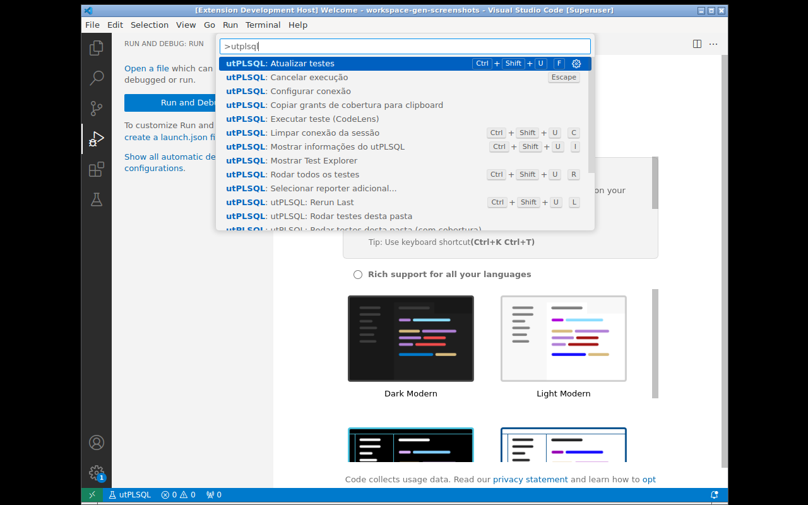
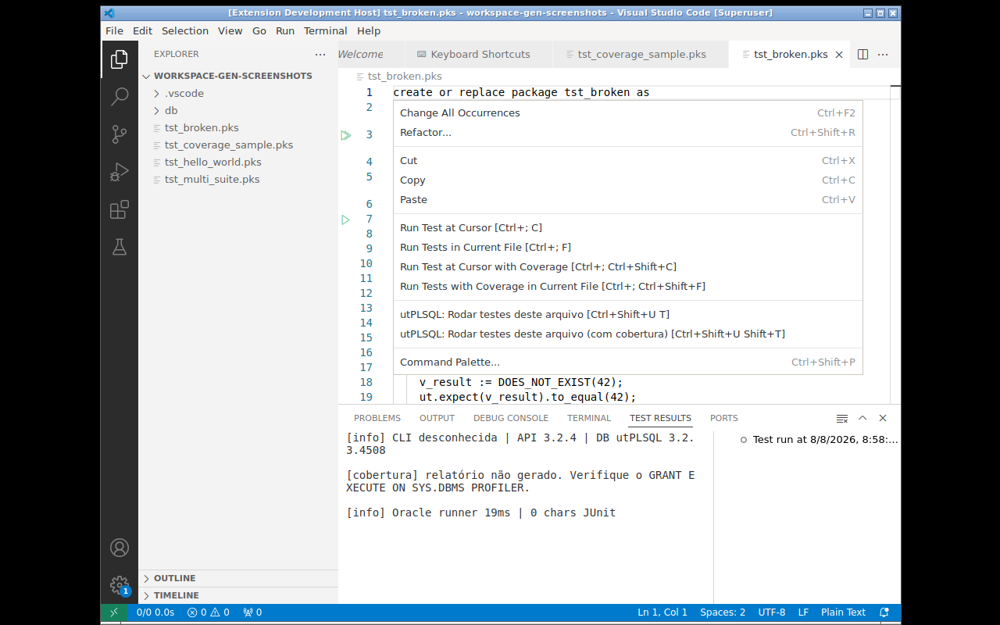
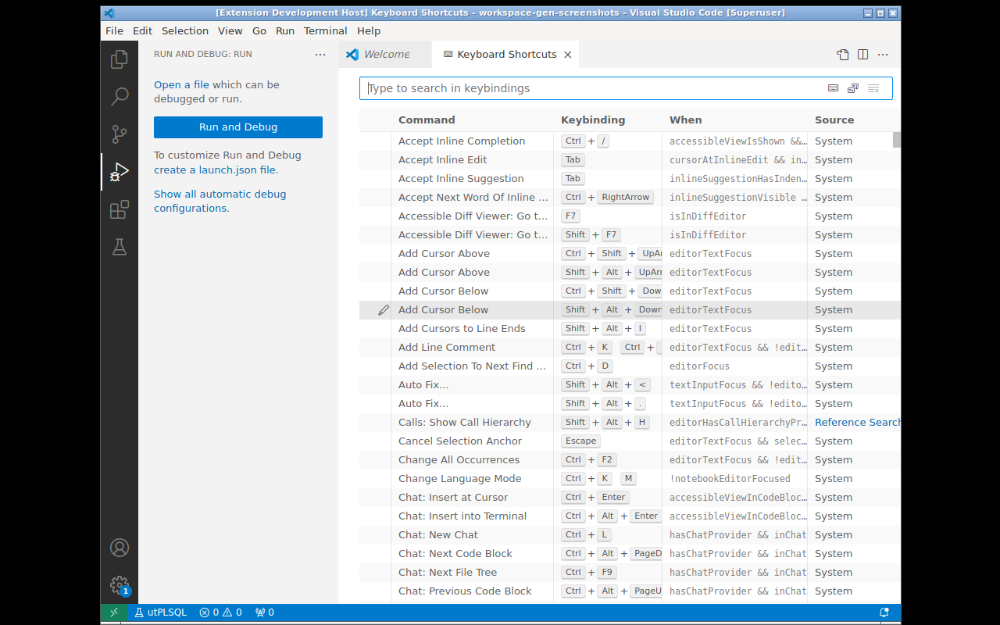

<!-- GENERATED FROM docs/brain/70-Wiki/Commands.md — DO NOT EDIT -->

# Commands

All extension commands available in the command palette (`Ctrl+Shift+P`),
prefixed with `utPLSQL:`.

## Full list

<!-- brain:auto:start:commands -->
| Command | ID | Description | UI shortcut |
|---|---|---|---|
| `Show Test Explorer` | `utplsql.showTestExplorer` | Focuses the Testing view | — |
| `Run test (CodeLens)` | `utplsql.runLens` | Internal — triggered by CodeLens buttons | ▶ button over `%suite`/`%test` |
| `Refresh tests` | `utplsql.refresh` | Forces rediscovery of `.pks` files | — |
| `Run all tests` | `utplsql.runAll` | Runs all suites in the workspace | ▶ button in Testing view |
| `utPLSQL: Run tests in this file` | `utplsql.runFile` | Runs suites from the active `.pks`/`.pkb` | Right-click → file |
| `utPLSQL: Run tests in this file (with coverage)` | `utplsql.runFileCoverage` | Same, with coverage profile | Right-click → file |
| `utPLSQL: Run tests in this folder` | `utplsql.runFolder` | Runs suites from the selected folder | Right-click → folder |
| `utPLSQL: Run tests in this folder (with coverage)` | `utplsql.runFolderCoverage` | Same, with coverage profile | Right-click → folder |
| `Cancel run` | `utplsql.cancelRun` | Stops the current execution | `Escape` |
| `Clear session connection` | `utplsql.clearConnection` | Removes connection from cache | — |
| `Show utPLSQL info` | `utplsql.showInfo` | API/DB versions | — |
| `Select additional reporter...` | `utplsql.selectReporter` | QuickPick with database reporters | — |
| `utPLSQL: Rerun Last` | `utplsql.rerunLast` | Repeats the last run | `Ctrl+Shift+U L` |
| `utPLSQL: Run Test at Cursor` | `utplsql.runAtCursor` | Runs the test under the cursor | `Ctrl+Shift+U U` |
| `utPLSQL: Run Failed Tests` | `utplsql.runFailed` | Re-runs only failed tests | `Ctrl+Shift+U X` |
| `utPLSQL: Toggle Coverage` | `utplsql.toggleCoverage` | Toggles the session coverage mode used by run commands without explicit coverage | Click on the status bar item |
| `utPLSQL: Run Tests by Tag...` | `utplsql.runByTag` | Multi-select QuickPick of discovered `%tags`; a `!tag` entry excludes it | — |
| `Configure connection` | `utplsql.configureConnection` | Opens settings at `utplsql.connection` | — |
| `Copy coverage grants to clipboard` | `utplsql.copyGrantsToClipboard` | Copies SQL grants to clipboard | — |
| `Validate setup` | `utplsql.validateSetup` | Runs full setup validation (including UT3 installation integrity) | — |
| `Switch Connection Profile...` | `utplsql.switchProfile` | QuickPick to switch the active connection profile | Click on status bar |
| `New Connection Profile...` | `utplsql.newProfile` | Creates a new connection profile | — |
| `Manage Connection Profiles` | `utplsql.manageProfiles` | Opens saved connection profiles | — |
| `utPLSQL: Set wallet password` | `utplsql.setWalletPassword` | Sets or clears the active profile's Oracle Cloud wallet password (stored in SecretStorage) | — |
| `utPLSQL: Run with Reporter (Export)` | `utplsql.runWithReporter` | Runs the selection with a chosen database reporter and writes the output to a dedicated Output channel or a file (`utplsql.reporter.*` settings) | Test Explorer item context menu |
| `Import SQL Developer Connections` | `utplsql.importSqlDevConnections` | Imports SQL Developer connections as profiles | — |
| `Debug Test (PL/SQL)` | `utplsql.debugTest` | Starts debugging a test via DBMS_DEBUG (`utplsql` Debug Adapter) | Editor context menu (`.pks`/`.pkb`) |
| `utPLSQL: Debug Test at Cursor` | `utplsql.debugAtCursor` | Starts a debug session of the `%test`/`%suite` under the cursor | — |
| `utPLSQL: Debug Failed Tests` | `utplsql.debugFailed` | Starts a debug session of the tests that failed in the last run (QuickPick when several) | — |
| `utPLSQL: Debug Last Run` | `utplsql.debugLast` | Starts a debug session of the last run | — |
| `utPLSQL: Compile for Debug` | `utplsql.compileForDebug` | Compiles the selected file/folder object with debug information (`ALTER … COMPILE DEBUG PLSQL_OPTIMIZE_LEVEL = 1`) | Editor/Explorer context menu |
| `utPLSQL: Rebuild Annotation Cache` | `utplsql.rebuildAnnotations` | Rebuilds the utPLSQL annotation cache in the database (`ut_runner.rebuild_annotation_cache`) and refreshes the tree | — |
| `utPLSQL: Run script` | `utplsql.runScript` | Runs the script open in the editor against a profile (connection QuickPick) | Right-click → `.sql`/`.pks`/`.pkb`/`.fnc`/`.prc`/`.trg` file |
| `utPLSQL: Run script file` | `utplsql.runScriptFile` | Runs an Explorer script file (decoded with the profile `charset`) | Right-click → file |
| `utPLSQL: Run script folder` | `utplsql.runScriptFolder` | Runs the folder scripts in alphabetical order (`utplsql.scriptRunner.filePattern` filter) | Right-click → folder |
| `utPLSQL: Generate test suite…` | `utplsql.generateTestSuite` | Generates `ut_<package>.pks` from a `.pks`/`.pkb` or a database object — one `%test` per routine, with the `utplsql.generate.*` settings | — |
| `utPLSQL: Run Related Tests` | `utplsql.runRelated` | Runs the suites related to the active production file, by the `ut_<object>` naming convention | Right-click → file |
<!-- brain:auto:end -->

> **Recompile UT3** does not appear in the palette — it is an internal quick-fix of
> the "utPLSQL Setup" diagnostic (`UTPLSQL_INVALID_OBJECTS`).

## Context menu

Execution commands also appear in the context menu:

- **Right-click on a file** `.pks`/`.pkb` → runs the suites in that file
- **Right-click on a folder** → runs the suites in all `.pks` files inside it
- **Right-click on a file** `.sql`/`.pks`/`.pkb`/`.fnc`/`.prc`/`.trg` → runs the script against a connection profile (output in the "utPLSQL Script" OutputChannel)
- **Right-click on a folder** → runs the folder scripts in alphabetical order

> SQL*Plus client directives (`PROMPT`, `SHOW ERRORS`, `SET`, `SPOOL`, `@file`, …)
> at the start of a statement are ignored (not sent to Oracle). `SET` is skipped
> only when it starts a statement, so `UPDATE … SET …` keeps working.

## Keyboard shortcuts

All shortcuts use the prefix `Ctrl+Shift+U` (`Cmd+Shift+U` on Mac):

| Shortcut | Command |
|---|---|
| `Ctrl+Shift+U R` | Run all tests |
| `Ctrl+Shift+U T` | Run tests in file |
| `Ctrl+Shift+U Shift+T` | Run tests in file with coverage |
| `Ctrl+Shift+U F` | Refresh tests |
| `Ctrl+Shift+U I` | Show utPLSQL info |
| `Ctrl+Shift+U C` | Clear session connection |
| `Ctrl+Shift+U L` | Rerun last |
| `Ctrl+Shift+U U` | Run at cursor |
| `Ctrl+Shift+U X` | Run failed only |
| `Ctrl+Shift+U Shift+C` | Toggle coverage |
| `Ctrl+Shift+U Shift+R` | Run related tests |
| `Ctrl+Shift+U D` | Debug at cursor |
| `Ctrl+Shift+U Shift+D` | Debug failed tests |
| `Escape` | Cancel run |

To customize, go to File → Preferences → Keyboard Shortcuts and search for `utplsql`.

