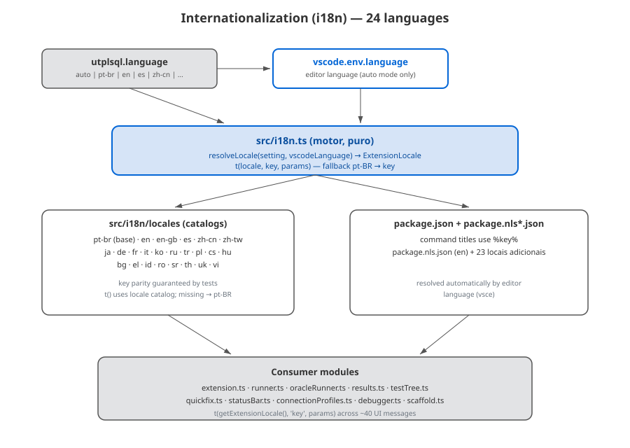

<!-- GENERATED FROM docs/brain/70-Wiki/Internationalization.md — DO NOT EDIT -->

# Internationalization (i18n)

The extension's runtime messages (prompts, output, diagnostics and quick-fixes)
follow your VSCode display language, and can be pinned with the
`utplsql.language` setting.

> Introduced in PRD-49.

## Setting

| Setting | Values | Default |
|---|---|---|
| `utplsql.language` | `auto` \| `pt-br` \| `en` \| `en-gb` \| `es` \| `zh-cn` \| `zh-tw` \| `ja` \| `de` \| `fr` \| `it` \| `ko` \| `ru` \| `tr` \| `pl` \| `cs` \| `hu` \| `bg` \| `el` \| `id` \| `ro` \| `sr` \| `th` \| `uk` \| `vi` | `auto` |

`auto` follows the VSCode locale: `pt` → `pt-br`, `zh-tw`/`zh-hk` → `zh-tw`, and
so on; anything unsupported falls back to `en`. A fixed value always wins.

## How it is split

| Layer | Source |
|---|---|
| Command / setting titles | `package.nls.json` + `package.nls.<locale>.json` (contributed by VSCode) |
| Runtime messages | `src/i18n.ts` (engine) + `src/i18n/locales/*.ts` (one per locale) |

```typescript
function resolveLocale(setting: string, vscodeLanguage: string): ExtensionLocale;
function t(locale: ExtensionLocale, key: string, params?): string;
```

- `t` interpolates `{param}` placeholders: `t(locale, 'key', { param: value })`.
- A missing key falls back to **pt-BR**, then to the key itself. It never throws.

## Formatting (PRD-88)

Numbers and durations shown to the user use the resolved locale:

```typescript
formatNumber(locale, 1234); // en → 1,234 · pt-BR → 1.234
formatDuration(locale, 12300); // en → 12.3 s · pt-BR → 12,3 s
formatDuration(locale, 850); // 850 ms
```

- `t()` formats the counting parameters (`count`, `total`, `current`); technical
  numbers (`line`, `ms`, identifiers) stay raw.
- The status bar and the Test Explorer duration suffix use these helpers;
  machine-readable formats (ISO dates, JUnit/Cobertura XML, PL/SQL) are never
  localized.



## Notes

- The catalogues cover the **24 locales** listed above (+ `auto`), so the setting
  has 25 valid values.
- Diagnostics from Oracle (e.g. `ORA-`, `DPI-`) are not translated — only the
  extension's own wrapper messages are.
